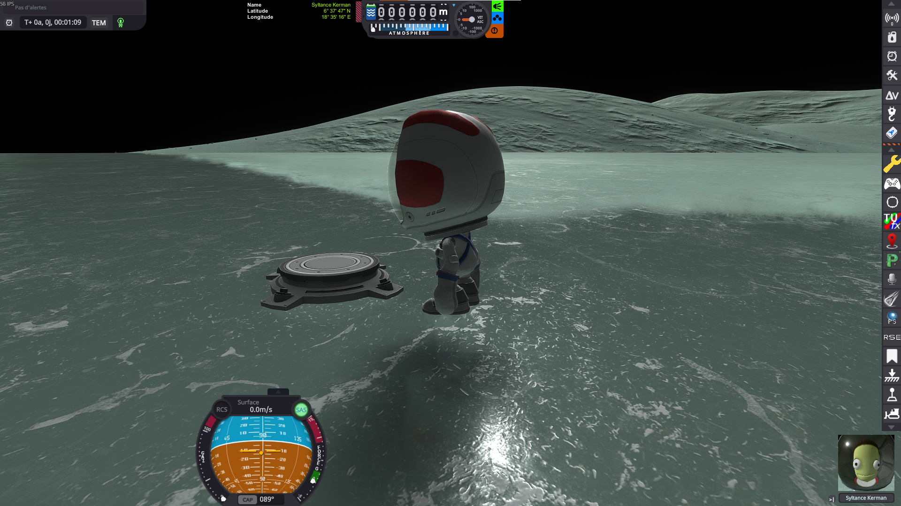

# EVA Construction Mode Ground Fix

A Kerbal Space Program mod that stops an engineer in EVA Construction Mode from moving a part into
the ground. Nothing in the game refuses it, and the damage only shows up on the next reload, when KSP
tries to put the vessel back above the surface.

It works on its own, and is best paired with
[TerrainPrecisionFix](https://github.com/lhervier/KSP-TerrainPrecisionFix): see
[Works best with TerrainPrecisionFix](#works-best-with-terrainprecisionfix).

## The problem

KSP's EVA Construction Mode lets a kerbal move a part anywhere — including *below* the surface.
Nothing in the game refuses that placement, and nothing warns about it. The damage only shows up on
the next reload, when the game tries to put the vessel back above the ground.

Here is the whole sequence, on Minmus.

### 1. An engineer deploys a ground anchor

A Stamp-O-Tron ground anchor is dropped on the surface, and becomes the root of the future structure.

### 2. Parts are attached to it in EVA Construction Mode

A first truss segment goes on the anchor…

…then a second one…

…then a third one.

### 3. A part is grabbed again, rotated and moved

The last segment is picked up and repositioned with the translation/rotation gizmo.

### 4. …and ends up in the ground

Nothing stops the segment from sinking into the surface: it is dropped there, half buried, and the
game accepts it as a perfectly valid placement.

### 5. Save, reload — and the structure is ruined

What happens next depends on whether [KSPCommunityFixes](https://github.com/KSPCommunityFixes/KSPCommunityFixes)
is installed, but neither outcome is the one you built.

**With KSPCommunityFixes.** The buried segment is no longer in the ground, but the whole structure
has been distorted to get it out: the trusses are twisted and splayed apart, and the assembly no
longer has the shape it was given.

**In stock.** The structure keeps its shape, but the game raises *everything* until no part is
underground — the ground anchor included. The anchor, which was bolted to the surface, now floats in
mid-air, and the whole structure hangs several meters above Minmus.

## The fix

This mod attacks the problem at the source: rather than repairing the vessel on reload, it makes the
invalid placement impossible in the first place. Step 4 above simply cannot happen — the part refuses
to go below the surface, so the reloaded structure is exactly the one that was built.

While EVA Construction Mode is on, the mod watches every part being moved and **truncates** the
requested move: the part travels up to the real ground contact, and stops there.

## Technical details

- Every collider of the moved part is tested against the scenery with Unity's physics system
  (`OverlapBox` / `OverlapCapsule` / `OverlapSphere`, then `ComputePenetration` to discard the
  overlaps that are not real penetrations).
- Box, capsule, sphere and mesh colliders are all supported.
- The move is truncated rather than refused, so a part always ends up in contact with the ground
  instead of anywhere above it.

## Works best with TerrainPrecisionFix

This mod stops a part at the ground it touches while it is being placed. It does that on its own,
with or without any other mod. But two stock behaviours, which have nothing to do with placing parts,
can still move what you built at the next load, and this mod cannot do anything about them.
[TerrainPrecisionFix](https://github.com/lhervier/KSP-TerrainPrecisionFix) fixes both.

**The ground does not come back at the same height.** KSP builds the ground again at every load, and
every time it lands at a slightly different height. A part this mod stopped right on the surface can
then come back slightly buried or slightly above it, and a large base can be strained at the first
physics frame. TerrainPrecisionFix rebuilds the ground at the very same height every time, so a part
stays where it was placed.

→ [Why the moving ground matters](https://github.com/lhervier/KSP-TerrainPrecisionFix/blob/main/README.md#why-the-moving-ground-matters)

**An anchored base is lifted at load.** KSP raises a vessel built on a ground anchor when it loads it,
and the anchor, riveted to the ground, holds it there: the anchor's spikes come out of the ground, and
a base can end up hanging in the air. This happens however carefully the parts were placed.
TerrainPrecisionFix loads an anchored base where it was saved.

→ [The ground anchor](https://github.com/lhervier/KSP-TerrainPrecisionFix/blob/main/README.md#the-ground-anchor)

Earlier versions of this mod kept anchored bases in place themselves, with a *Keep anchored bases in
place* setting. That job is now TerrainPrecisionFix's, and the setting is gone.

## Settings

The mod adds a button to the application launcher (in flight and at the space center) that opens a
small settings window with a single setting, the **log level**: how much the mod writes to `KSP.log`.

It is a setting of the *installation*, not of a save: it is stored in
`GameData/EvaCMGroundMod/PluginData/settings.cfg` and applied as soon as it is changed. Deleting that
file restores the default.

Earlier versions also had a *Ground offset* setting, to stop a part some distance above the ground.
It is gone: a part now always stops right at the contact.

## Installation

1. Download the latest release
2. Extract the contents to your KSP GameData folder
3. The fix activates when you enter EVA Construction Mode

## Requirements

- Kerbal Space Program 1.12 or later
- Breaking Ground DLC (for EVA Construction Mode)

## License

This mod is released under the MIT License. See the LICENSE file for details.
